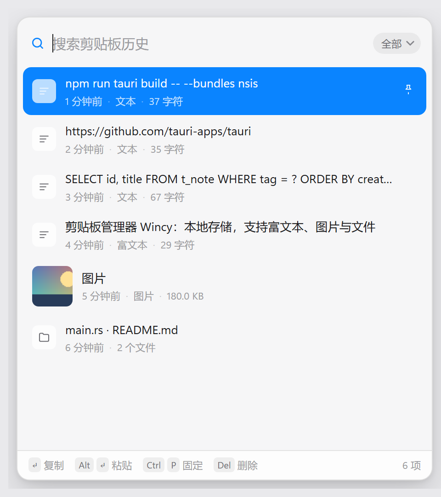
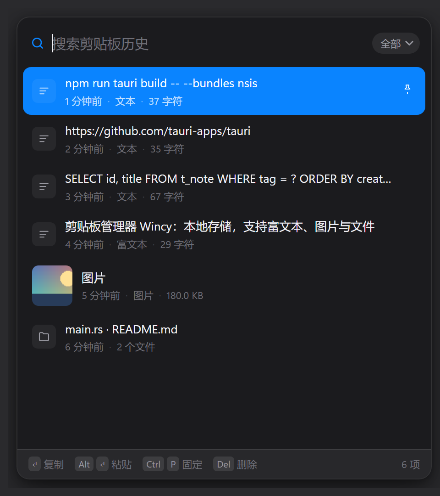

<div align="center">


# Wincy

**Maccy for Windows** — a lightweight, keyboard-first, fully local clipboard manager.

Tauri 2 + native Win32. 1.3 MB installer, ~20 MB resident memory.

[中文](README.md) · [Download](#install) · [Build](#build-from-source) · [Shortcuts](#shortcuts)

</div>

---

<div align="center">


&nbsp;&nbsp;


</div>

## Features

| | |
|---|---|
| **Hotkey popup** | <kbd>Alt</kbd>+<kbd>V</kbd> by default, any combo can be recorded. Appears at the cursor, or bottom-right / top-right / center / last dragged position |
| **Keyboard first** | Type to filter, <kbd>↑</kbd><kbd>↓</kbd> to select, <kbd>Enter</kbd> to copy, <kbd>Alt</kbd>+<kbd>Enter</kbd> to paste straight into the previous window |
| **All the formats** | Plain text, rich text (HTML preserved), images, file lists — written back in their original format |
| **Privacy aware** | Honors `ExcludeClipboardContentFromMonitorProcessing` and `CanIncludeInClipboardHistory`, so items password managers mark as concealed are never recorded |
| **Pin & filter** | <kbd>Ctrl</kbd>+<kbd>P</kbd> to pin (pinned items don't count toward the limit); filter by text / image / files |
| **Stay on screen** | Optional "keep on screen" mode: the popup survives copying and losing focus, for steady repeated use |
| **Looks** | System / light / dark plus 8 accent colours. Both windows are freely resizable and remember their size |
| **Quiet resident** | Single instance, tray icon, optional launch at login; a rejected hotkey keeps the previous one and tells you |

## Shortcuts

| Key | Action |
|---|---|
| <kbd>Enter</kbd> | Copy the selected item and close |
| <kbd>Alt</kbd>+<kbd>Enter</kbd> | Copy and paste into the previous window |
| <kbd>Alt</kbd>+<kbd>Shift</kbd>+<kbd>Enter</kbd> | Paste as plain text |
| <kbd>↑</kbd> <kbd>↓</kbd> / <kbd>Ctrl</kbd>+<kbd>N</kbd> | Move selection |
| <kbd>PageUp</kbd> <kbd>PageDown</kbd> | Jump a page |
| <kbd>Tab</kbd> | Cycle the type filter |
| <kbd>Ctrl</kbd>+<kbd>P</kbd> | Pin / unpin |
| <kbd>Delete</kbd> or <kbd>Ctrl</kbd>+<kbd>Backspace</kbd> | Delete the item |
| <kbd>Ctrl</kbd>+<kbd>,</kbd> | Open settings |
| <kbd>Esc</kbd> | Close the popup |

## Install

Grab `Wincy_x.y.z_x64-setup.exe` from [Releases](../../releases) and run it. Windows 10 / 11 x64, with the built-in WebView2 runtime (preinstalled on Windows 11).

It installs per-user, no admin rights needed. The tray menu offers open / settings / pause monitoring / clear history / quit.

## Build from source

Requirements:

- Windows 10 / 11 x64
- [Rust](https://rustup.rs/) 1.77+ (MSVC toolchain)
- Visual Studio Build Tools with the C++ workload and Windows SDK
- Node.js 18+ (only to invoke the Tauri CLI)

```bash
npm install
npx tauri dev      # development
npx tauri build    # produces the NSIS installer
```

The installer lands in `src-tauri/target/release/bundle/nsis/`.

## Data & privacy

- Everything stays on your machine in `%APPDATA%\app.wincy.clipboard\`: `history.json` for text, `images/` for pictures.
- No network access, no telemetry, no accounts. Nothing outside WebView2 is required at runtime.
- Pause monitoring or wipe the history from the tray menu. A history limit of 0 means unlimited.

## Project layout

```
src/                 build-step-free frontend (plain HTML / CSS / JS)
  index.html         popup: search + list
  settings.html      settings window
  app.js             rendering, keyboard handling, incremental paging
  theme.js           light/dark + accent, resolved before first paint
  resize.js          custom resize grips for the borderless windows
src-tauri/src/
  main.rs            window placement & activation, tray, hotkeys, commands
  clipboard.rs       raw clipboard I/O (CF_UNICODETEXT / CF_HTML / CF_DIB / CF_HDROP)
  store.rs           history persistence and trimming (pins excluded from the limit)
docs/                screenshots used by the README
```

## Known limitations

- Windows only. Large parts talk to Win32 directly (clipboard, `SetForegroundWindow` activation, DPI-aware placement); a port means rewriting those.
- The popup relies on a transparent window for rounded corners and its shadow — a few GPU drivers can show a dark fringe.
- History is rewritten as a single `history.json`, so with tens of thousands of items each copy costs a little disk I/O.

## Credits

Interaction and information density are modelled on [Maccy](https://maccy.app/) for macOS (MIT). This is an independent Windows implementation, not affiliated with Maccy's author.

## License

[MIT](LICENSE)
