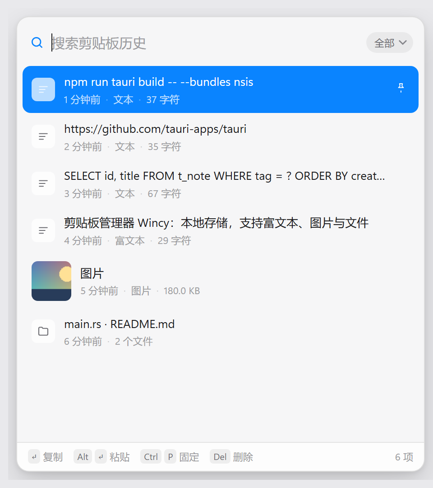
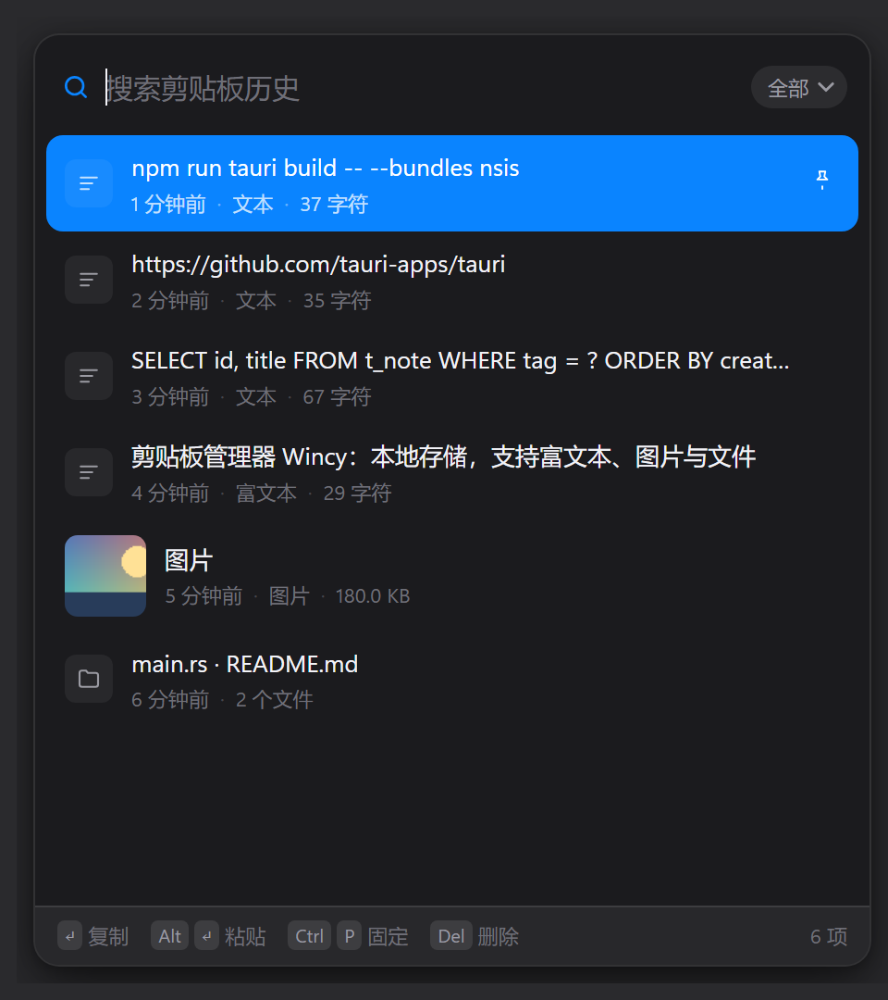

<div align="center">


# Teecy

**Windows 上的 Maccy** —— 轻量、键盘优先、纯本地的剪贴板历史管理器。

Tauri 2 + 原生 Win32，安装包 1.3 MB，常驻内存约 20 MB。

[English](README.en.md) · [下载](#安装) · [构建](#从源码构建) · [快捷键](#快捷键)

</div>

---

<div align="center">


&nbsp;&nbsp;


</div>

## 功能

| | |
|---|---|
| **快捷键唤出** | 默认 <kbd>Alt</kbd>+<kbd>V</kbd>，可在设置里录制任意组合键；在光标附近弹出（可改为右下角 / 右上角 / 居中 / 记住的位置） |
| **键盘优先** | 输入即过滤，<kbd>↑</kbd><kbd>↓</kbd> 选择，<kbd>Enter</kbd> 复制，<kbd>Alt</kbd>+<kbd>Enter</kbd> 直接粘贴到上一个窗口 |
| **多格式** | 纯文本、富文本（保留 HTML 格式）、图片、文件列表；粘贴时按原格式写回剪贴板 |
| **隐私过滤** | 识别 `ExcludeClipboardContentFromMonitorProcessing`、`CanIncludeInClipboardHistory` 等标记，密码管理器标记为机密的条目不会被记录 |
| **固定与搜索** | <kbd>Ctrl</kbd>+<kbd>P</kbd> 固定常用条目（不计入上限），按类型筛选（全部 / 文本 / 图片 / 文件） |
| **常驻桌面** | 可选「复制后保持显示」：复制完不消失、失去焦点也不消失，适合连续取用 |
| **外观** | 跟随系统 / 浅色 / 深色 + 8 种主题色；弹窗和设置窗口均可自由缩放并记住尺寸 |
| **无感常驻** | 单实例、托盘常驻、开机自启可选；自定义热键冲突时保留旧键并提示 |

## 快捷键

| 按键 | 作用 |
|---|---|
| <kbd>Enter</kbd> | 复制选中项并关闭 |
| <kbd>Alt</kbd>+<kbd>Enter</kbd> | 复制并粘贴到上一个窗口 |
| <kbd>Alt</kbd>+<kbd>Shift</kbd>+<kbd>Enter</kbd> | 以纯文本粘贴 |
| <kbd>↑</kbd> <kbd>↓</kbd> / <kbd>Ctrl</kbd>+<kbd>N</kbd> | 上下移动 |
| <kbd>PageUp</kbd> <kbd>PageDown</kbd> | 快速翻页 |
| <kbd>Tab</kbd> | 切换类型筛选 |
| <kbd>Ctrl</kbd>+<kbd>P</kbd> | 固定 / 取消固定 |
| <kbd>Delete</kbd> 或 <kbd>Ctrl</kbd>+<kbd>Backspace</kbd> | 删除条目 |
| <kbd>Ctrl</kbd>+<kbd>,</kbd> | 打开设置 |
| <kbd>Esc</kbd> | 关闭弹窗 |

## 安装

从 [Releases](../../releases) 下载 `Teecy_x.y.z_x64-setup.exe`，双击安装。仅支持 Windows 10 / 11（x64），需要系统自带的 WebView2 运行时（Win11 默认包含）。

安装到当前用户目录，不需要管理员权限。首次启动后在托盘右键可「打开 / 设置 / 暂停记录 / 开机自动启动 / 清空历史 / 退出」。

## 从源码构建

环境要求：

- Windows 10 / 11 x64
- [Rust](https://rustup.rs/) 1.77+（MSVC 工具链）
- Visual Studio Build Tools（含 VC++ 生成工具与 Windows SDK）
- Node.js 18+（仅用于调用 Tauri CLI）

```bash
npm install
npx tauri dev      # 开发
npx tauri build    # 生成 NSIS 安装包
```

产物在 `src-tauri/target/release/bundle/nsis/`。

## 数据与隐私

- 全部数据保存在本机 `%APPDATA%\app.teecy.clipboard\`：`history.json` 存文本，`images/` 存图片。
- 不联网、不上传、无统计。除 Windows 自带的 WebView2 外没有任何运行时依赖。
- 托盘菜单可暂停记录、勾选开机自启或清空历史；「历史条数上限」填 0 表示不限制。
- 开机自启写入的是当前用户的 Run 注册表项（带引号的完整路径），安装目录里有空格也不会失效；程序换目录安装后会自动修正指向。

## 项目结构

```
src/                 无构建步骤的前端（原生 HTML / CSS / JS）
  index.html         弹窗（搜索 + 列表）
  settings.html      设置窗口
  app.js             列表渲染、键盘处理、增量分页
  theme.js           明暗 / 主题色，首帧同步避免闪色
  resize.js          无边框窗口的自定义缩放手柄
src-tauri/src/
  main.rs            窗口定位与激活、托盘、热键、命令注册
  clipboard.rs       原生剪贴板读写（CF_UNICODETEXT / CF_HTML / CF_DIB / CF_HDROP）
  store.rs           历史持久化与裁剪（固定项不计入上限）
docs/                README 用截图
```

## 已知限制

- 只支持 Windows；代码里大量直接调用 Win32（剪贴板、`SetForegroundWindow` 抢焦点、DPI 感知定位），移植需要重写这部分。
- 弹窗使用透明窗口做圆角和投影，极少数显卡驱动下可能出现黑边。
- 历史记录整份写入 `history.json`，几万条时每次复制会有一点点写盘开销；如需超大历史建议改为分片存储。

## 致谢

交互与信息密度参考了 macOS 上的 [Maccy](https://maccy.app/)（MIT）。本项目为独立的 Windows 实现，与 Maccy 作者无关联。

## License

[MIT](LICENSE)
